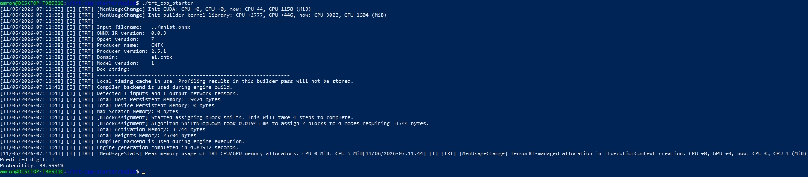



最近在学习模型部署，模仿 [该博客](https://www.cnblogs.com/CrescentWind/p/18229812)，实现了一个简易的模型部署流程，位于 [该仓库](https://github.com/Amroning26/trt-cpp-starter)  中，用于理解。为了不遗忘，在该篇文章中记录学到的东西。

先记录一下环境配置过程，然后再介绍代码内容。


# 环境配置

我的环境是 WSL，Ubuntu 24.04，Windows 侧已支持 WSL CUDA 的 NVIDIA 驱动。WSL 侧需要安装：

```
OpenCV C++ 开发包
CUDA Toolkit
TensorRT Runtime、开发头文件、ONNX Parser
TensorRT Samples 中的 logger.h 和 logger.cpp
```

需要 logger.h 和 logger.cpp， 是因为构建 Runtime、OnnxParser 等工具的时候，需要传入 `nvinfer1::ILogger &logger`，是一个抽象接口，要求提供 `log()` 实现。TensorRT 没有一个固定的日志类，因为日志应该由开发者决定如何处理，可以自己根据 `nvinfer1::ILogger &logger`自己实现一个日志类，我这里就从简使用 TensorRT Samples 中的示例日志类了


- 安装基础工具和 OpenCV 

```bash
sudo apt update
sudo apt install -y build-essential g++ cmake pkg-config git wget curl unzip libopencv-dev
```


确认 OpenCV 安装成功，能看到版本号

```bash
pkg-config --modversion opencv4
```


-  安装 CUDA Toolkit

添加 CUDA 官方源：

```bash
wget https://developer.download.nvidia.com/compute/cuda/repos/ubuntu2404/x86_64/cuda-keyring_1.1-1_all.deb
sudo dpkg -i cuda-keyring_1.1-1_all.deb
sudo apt update
```


安装 CUDA 12.8 Toolkit ：

```bash
sudo apt install -y cuda-toolkit-12-8
```


设置环境变量：

```bash
cat >> ~/.bashrc <<'EOF'
export PATH=/usr/local/cuda/bin:$PATH
export LD_LIBRARY_PATH=/usr/local/cuda/lib64:${LD_LIBRARY_PATH}
EOF

source ~/.bashrc
nvcc --version
```

看到 nvcc 信息，这部分就算成功了


- 安装 TensorRT

```bash
sudo apt install tensorrt=10.9.0.34-1+cuda12.8 tensorrt-dev=10.9.0.34-1+cuda12.8 libnvinfer-samples=10.9.0.34-1+cuda12.8
```

目前代码中有一些旧接口，为了不报错先装了 TensorRT 10.9 的版本。以后优化代码的的时候再去掉旧接口。


确认版本：

```bash
dpkg-query -W -f='${Package} ${Version}\n' tensorrt tensorrt-dev libnvinfer-dev libnvonnxparsers-dev
```


如果不想自己实现日志类，就可以和我一样下载 TensorRT Samples 的来用：

```bash
sudo git clone --depth 1 https://github.com/NVIDIA/TensorRT.git /usr/src/tensorrt
```


# 文件准备

- 因为是为了学习模型部署，重点不在模型训练，我直接下载了微软官方 `onnxjs-demo` 项目中提供的 `mnist.onnx` 模型文件：

```
https://github.com/microsoft/onnxjs-demo/raw/master/public/mnist.onnx
```


- 用来测试的数字图片文件，要尽量保持和 mnist 数据集一样，黑底白字，数字居中：


# 代码部分


先对 部署/推理过程 有个大致印象（参考 [博客](https://www.cnblogs.com/shaoxx333/p/16630781.html)）：

模型初始化 -> 输入数据预处理 -> 数据从内存拷贝到 cuda 显存 -> 推理 -> 推理结果从 cuda 显存拷贝回内存 -> 推理结果后处理


## 模型初始化

这部分对应 `mian.cpp`中的

```cpp
        EngineManager manager("../mnist.onnx", "../mnist.engine");

        if (!manager.loadOrBuild()) {
            std::cerr << "Failed to load or build engine\n";
            return 1;
        }
```


- 贴一段官方说明：ONNX 是一种用于表示机器学习模型的开放格式，描述了模型的计算图，例如有哪些算子、权重和张量，以及它们之间如何连接

我自己就理解成：ONNX 就是把训练好的模型保存成一种通用格式，这样就可以不依赖 pytorch，在各种环境中使用


- `.engine` 是 TensorRT 将模型构建后序列化得到的文件，是 TensorRT 可以直接反序列化成运行时环境的产物。构建时，TensorRT 会根据模型和当前构建配置生成执行计划


- ONNX 是构建 engine 的输入；engine 是 TensorRT 的执行产物

  当前程序构建完成后，会用内存里的 `engine` 创建执行上下文并推理。下次运行时，程序从文件读取 engine 数据，通过 `deserializeCudaEngine` 恢复它，再交给同一套推理流程使用


- 为什么要把 engine 序列化保存成本地 `.engine`：

  构建 engine 需要解析 ONNX、进行优化并生成执行计划，会比读取已有 engine 更耗时。把 engine 写入磁盘后，后续启动可以跳过这段构建过程，缩短初始化时间；部署时也可以只带 engine 文件，省去现场构建的等待和部分构建依赖

  engine 与 TensorRT 版本、GPU 硬件和构建配置相关，不能像 ONNX 一样当作通用模型文件随处复用。如果换了环境，已有 engine 基本都会无法加载或不再合适，就需要重新从 ONNX 构建


所以当前代码的结构是：

​	1. 优先根据已存在的 `.engine` 文件反序列化：`bool EngineManager::loadSerializedEngine()`

该函数中的一点细节：

- `std::ifstream file(engine_path_, std::ios::binary | std::ios::ate);`

  `std::ios::binary` 按二进制方式读取，`.engine` 中是序列化后的字节数据，不是文本，二进制模式可避免某些系统对文本换行符等内容做转换；

  `std::ios::ate` 表示打开文件后立即把读取位置放到文件末尾（ate 全称 at end）。这样接下来调用 `tellg()` 就能取得文件末尾的位置，也就是文件大小。

- `const std::streamsize size = file.tellg();`

  `tellg()` 返回当前读取位置，因为文件刚打开时位置在末尾，这个值就是文件的字节数。返回类型是 `std::streampos`，这里赋给 `std::streamsize`，用于后续检查文件是否为空，并分配相应大小的缓冲区

- `file.seekg(0, std::ios::beg);`

  `seekg` 设置读取位置，这里将位置设为相对于文件开头 `std::ios::beg` 的偏移 `0`，也就是回到文件第一个字节。这样下面的 `file.read(...)` 才会从头开始把整个 engine 文件读入缓冲区


2. 如果 `.engine` 不存在，才会从加载 ONNX 开始构建运行时环境：`bool EngineManager::buildEngineFromOnnx() `

- 该函数看作是从 ONNX 构建 TensorRT engine 的初始化流程，步骤是：

  ```
  创建 Builder
      ↓
  创建 Network（模型在 TensorRT 内部的计算图）
      ↓
  创建 ONNX Parser，将 ONNX 解析进 Network
      ↓
  创建 Config，设置精度、工作空间等构建选项
      ↓
  Builder 根据 Network 和 Config 构建 Engine
      ↓
  将 Engine 序列化并保存到文件
  ```

- 以下代码（旧内容，代码已修改，下方说明）：

  ```c++
      const auto explicit_batch = 1U << static_cast<uint32_t>(nvinfer1::NetworkDefinitionCreationFlag::kEXPLICIT_BATCH);
  
      NetworkPtr network{builder->createNetworkV2(explicit_batch)};
  ```

  `createNetworkV2()` 接收的是一个标志位集合，每一位代表一个选项；

  `kEXPLICIT_BATCH`：表示该选项对应的位编号，这里值为0；

  `static_cast<uint32_t>(...)`：把枚举转换为整数，作为移位次数；

  `1U << ...`：把无符号整数 1 左移到对应位置，开启这一位

`kEXPLICIT_BATCH` 表示 batch 维度也是张量形状的一部分。如，图像输入的形状直接写为：`[N, C, H, W]`。旧的隐式 batch 模式则将 batch 单独处理，网络里的形状只表示 `[C, H, W]`。

从 TensorRT 10.0 开始，网络始终采用显式 batch，这个标志已经弃用且被忽略。对当前的 TensorRT 10.9.0.34 来说，`kEXPLICIT_BATCH` 仍在 API 中，可以编译使用，但已被标记为弃用，编译的时候会有警告：

```bash
warning: ‘nvinfer1::NetworkDefinitionCreationFlag::kEXPLICIT_BATCH’ is deprecated [-Wdeprecated-declarations]
```


※ 此部分已更新为：

```c++
NetworkPtr network{builder->createNetworkV2(0U)};
```


- 以下代码（旧内容，代码已修改，下方说明）：

  ```c++
      if (builder->platformHasFastFp16()) {
          config->setFlag(nvinfer1::BuilderFlag::kFP16);
      }
  ```

  先检查当前平台是否具备较快的 FP16 计算能力；如果具备，就允许 TensorRT 在构建时选用 FP16 实现。

FP16 是 16 位浮点数，相比 FP32，通常会减少显存占用和数据传输量，并利用 GPU 的相应硬件获得加速，但数值精度也会降低。

这里的含义是允许使用 FP16，不是强制所有层都使用 FP16。TensorRT 会根据算子支持情况、性能和约束选择实现，也不保证每个模型都一定加速。

新版 TensorRT 正在转向 强类型网络，由模型中的张量类型明确决定精度。`platformHasFastFp16()` 也已弃用，在当前版本该函数仍然存在并可调用，但 不建议新代码继续依赖它，编译会弹警告：

```bash
warning: ‘bool nvinfer1::IBuilder::platformHasFastFp16() const’ is deprecated [-Wdeprecated-declarations]
```


※ 此部分已更新为：

```cpp
    int device = 0;
    if (cudaGetDevice(&device) != cudaSuccess) {
        return false;
    }

    cudaDeviceProp properties{};
    if (cudaGetDeviceProperties(&properties, device) != cudaSuccess) {
        return false;
    }

    if(properties.major > 5 || (properties.major == 5 && properties.minor >= 3)){
        config->setFlag(nvinfer1::BuilderFlag::kFP16);
    }
```

（1）`cudaGetDevice()` 取得当前 CUDA 设备的编号，写入device；

（2）`cudaDeviceProp` 用来保存设备属性，`cudaGetDeviceProperties()` 根据设备编号填入属性；

（3）`major` 和 `minor` 是 GPU 的 compute capability 主、次版本号。这个条件表示版本高于 5.x，或恰好为 5.x 且次版本至少为 3，也就是 compute capability 5.3 或更高时，设置 TensorRT 的 kFP16 构建标志


- `config->setMemoryPoolLimit(nvinfer1::MemoryPoolType::kWORKSPACE,256ULL << 20);`

把 workspace 内存池的上限设置为 256 M：

```
256ULL << 20
// 相当于 256 × 2²⁰ 字节
// ULL 表示 unsigned long long 类型的整数
```

workspace 是算子执行时可能需要的临时工作空间，不是整个程序的显存上限，也不是立即分配 256 M。 模型权重、输入输出缓冲区等还有各自的显存开销，它约束的是这一类临时工作空间，影响 TensorRT 构建时可选择的执行方案。


## 输入数据预处理

输入数据预处理负责把原始数据转换为模型期望的输入。对于图像，这通常涉及调整尺寸、处理颜色通道、转换数据类型和调整数值范围，最后按模型要求组织张量的形状与数据排列。具体步骤取决于模型训练和导出时使用的预处理方式，也要符合 engine 的输入要求。如果推理时使用的处理方式与训练时不一致，即使 engine 可以正常运行，预测结果也可能变差。


现在的输入是图片，需要知道：

- 图片可以看作一个数组：
  - 灰度图是二维的，高度 × 宽度，每个位置存一个亮度值；
  - 彩色图一般是三个通道，每个像素分别存三个颜色分量；
  - 有些图片还有第四个通道，通常是 alpha 透明度。
- 常见图像张量形状有：
  - `NCHW`：批次、通道、高度、宽度。
  - `NHWC`：批次、高度、宽度、通道。

- OpenCV 默认以 BGR 顺序读取三通道彩色图。单张图像通常按 HWC 的方式交错存储；而一些模型要求 RGB 顺序和 NCHW 输入。颜色通道顺序与张量维度顺序是两个不同的概念，需要分别检查和转换。


目前代码中使用的预处理函数是 `cv::Mat process(const std::string& image_path) const`，过程比较直观：

读取图片 → 按通道数转换为灰度图 → 缩放到 28 × 28 → 转换为 32 位浮点数，并将像素值乘以 1/255


还有一个目前没有用到的函数 hwc2chw，用于将图像数据从 HWC 排列转换为 CHW 排列。本例处理的是单通道图像，当通道数为 1 时，这两种排列的连续像素顺序相同，因此不需要重排数据。`process()` 返回的是单通道 `cv::Mat`，批次和通道维度由模型输入的解释方式决定


## 推理

这一步总体的流程为：

初始化推理器 -> 创建 CUDA stream，在 GPU 上分配输入、输出缓冲区 -> 将输入从 CPU 内存复制到 GPU 输入缓冲区 -> 执行推理 -> 将 GPU 输出缓冲区中的数据异步复制回 CPU 


构造 Runner `InferenceRunner runner(*manager.engine());`中，传入前面构造的 engine，进行推理器的初始化。记录一些知识点：

- `nvinfer1::Dims` 是 TensorRT 用来表示张量维度信息的结构体。可以把它理解成一个固定容量的整数列表，`nbDims` 表示当前有几个维度，`d[]` 存放各维的大小。

```cpp
    const nvinfer1::Dims input_dims = engine_.getTensorShape(input_name_);

    const nvinfer1::Dims output_dims = engine_.getTensorShape(output_name_);
```

`getTensorShape()` 根据输入 tensor 的名字向 engine 查询形状，返回 `Dims`。接着 `tensorSize()` 遍历其中每个维度并相乘：

```cpp
for (int i = 0; i < dims.nbDims; ++i) {
    size *= dims.d[i];
}
```

得到元素总数。


- 可以把 `ICudaEngine` 理解为模型的执行计划，把 `IExecutionContext` 理解为按某组输入和运行状态执行这份计划的实例。

  engine 保存 TensorRT 构建好的模型信息和执行方案，描述模型如何计算，但推理时还需要一份运行时状态，如，输入输出 tensor 的地址、动态输入尺寸，以及执行过程所需的状态。`IExecutionContext` 承担这部分工作。

  runner 构造时创建 context：

  ```cpp
  std::unique_ptr<nvinfer1::IExecutionContext, TrtContextDeleter> context_;
  
  context_.reset(engine_.createExecutionContext());
  ```

  随后将 GPU 输入、输出缓冲区绑定到 context：

  ```cpp
  context_->setTensorAddress(input_name_, device_input_.data());
  context_->setTensorAddress(output_name_, device_output_.data());
  ```


- `InferenceRunner::infer(const cv::Mat& input)` 接收预处理后的图像，执行一次 TensorRT 推理，并把模型输出作为 `std::vector<float>` 返回。

  - 将输入从 CPU 内存异步复制到 GPU：

  ```cpp
      checkCuda(
          cudaMemcpyAsync(device_input_.data(), input.ptr<float>(), input_size_ * sizeof(float), cudaMemcpyHostToDevice, stream_.get()), "cudaMemcpyAsync host to device");
  ```

  `cud22aMemcpyAsync` 的函数签名：

  ```
  dst：目标地址，这里是 GPU 上预先分配的输入缓冲区。
  src：源地址，这里是 CPU 上 cv::Mat 的像素数据起始地址。
  count：复制的字节数。
  kind：复制方向，cudaMemcpyHostToDevice 表示从 CPU 主机内存复制到 GPU 设备内存。
  stream：把这次复制提交到哪条 CUDA stream。
  ```

  

  `cudaStream_t` 是 CUDA 提供的 stream 句柄类型，可以把它理解为一条 GPU 工作队列的编号，CPU 把内存复制、kernel 或 TensorRT 推理等工作提交到这条队列，GPU 按该 stream 中的先后顺序执行。

  

  - 让 TensorRT 执行 engine：

    ```cpp
    context_->enqueueV3(stream_.get())
    ```

    `context_` 依据构造时绑定的输入、输出地址执行模型，推理工作也提交到同一条 stream。

  - 准备 CPU 输出容器，并把 GPU 输出异步复制回来：

    ```cpp
        std::vector<float> output(static_cast<std::size_t>(output_size_));
    
        checkCuda(
            cudaMemcpyAsync(output.data(), device_output_.data(), output_size_ * sizeof(float), cudaMemcpyDeviceToHost, stream_.get()), "cudaMemcpyAsync device to host");
    ```

  - 等待 stream 完成，再返回结果：

    ```cpp
        checkCuda(cudaStreamSynchronize(stream_.get()), "cudaStreamSynchronize");
    
        return output;
    ```

    `cudaStreamSynchronize(stream)` 等待指定 stream 中此前提交的所有操作完成。


## 推理结果后处理

后处理把 TensorRT 返回的 `output` 向量转换成两个更直观的结果，预测类别 `label` 和该类别对应的 `probability`。

需要记录一下的就是用 Softmax 计算最大项的概率：

```cpp
    float max_value = output[best_index];
    float sum = 0.0f;

    for (float value : output) {
        sum += std::exp(value - max_value);
    }

    float probability = std::exp(output[best_index] - max_value) / sum;
```

$$
\frac{e^{z_i-m}}{\sum_j e^{z_j-m}}
=
\frac{e^{z_i}}{\sum_j e^{z_j}}
$$

`output` 是模型给各类别的分数，logits。先减去最大值再取指数，数学结果不变，但能降低指数运算溢出的风险。`best_index` 指向最大值，分子在这里就是 exp(0)，即 1；分母里的每一项表示某个类别相对于最大分数的权重。也就是先把每个类别分数变成正权重，再计算最大类别权重占全部权重多少。减去最大值只是为了让计算更稳定，防止溢出，不会改变最终比例。


贴一张运行结果：


